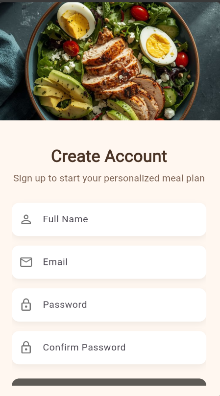
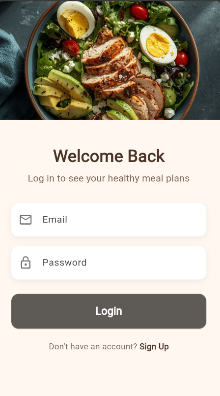
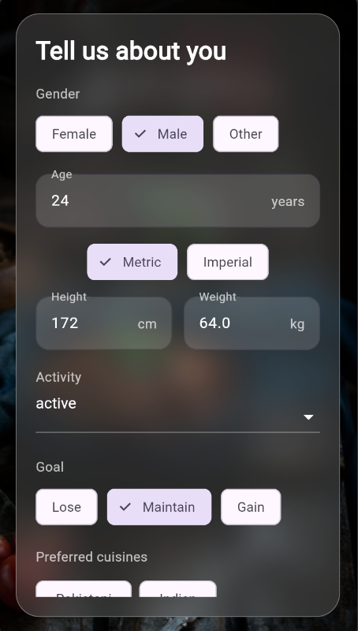
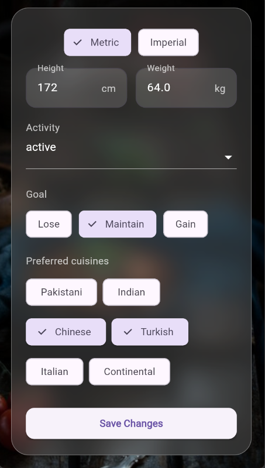
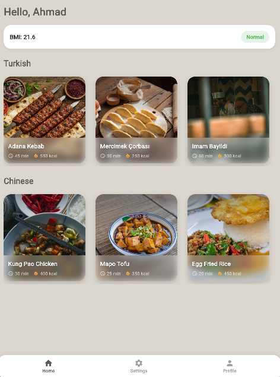
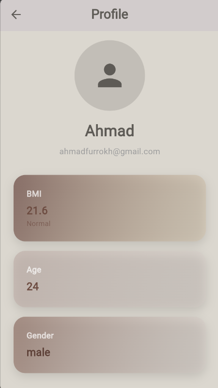
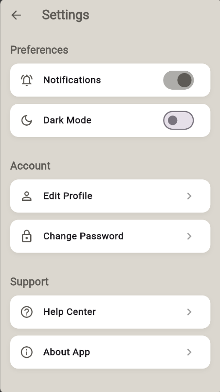

# NutriNova – AI-Based Diet & Recipe App

NutriNova is a Flutter app that builds a personalised diet profile (BMI, goal, activity level, preferred cuisines) and uses **Google Gemini** to generate recipes for the cuisines you like, with food photos from **Pixabay**. Authentication and user data are handled by **Firebase**.

## Features

- Email sign up / login with Firebase Authentication
- Onboarding flow to capture gender, age, height, weight (metric / imperial), activity level, goal and preferred cuisines
- Automatic BMI calculation with a health status badge
- AI-generated recipes (name, calories, cooking time, ingredients, directions) per cuisine using Gemini
- Recipe photos fetched from the Pixabay API
- Profile, settings, change password, help center and about screens
- Light / dark theme toggle

## Screenshots

### Authentication

<table>
  <tr>
    <td align="center"><br><b>Sign Up</b></td>
    <td align="center"><br><b>Login</b></td>
  </tr>
</table>

### Onboarding

<table>
  <tr>
    <td align="center"><br><b>Profile Setup (1)</b></td>
    <td align="center"><br><b>Profile Setup (2)</b></td>
  </tr>
</table>

### Main App

<table>
  <tr>
    <td align="center" valign="top"><br><b>Home</b></td>
    <td align="center" valign="top"><br><b>Profile</b></td>
    <td align="center" valign="top"><br><b>Settings</b></td>
  </tr>
</table>

## Tech Stack

- Flutter / Dart
- Firebase Auth, Cloud Firestore
- Google Generative AI (Gemini 2.5 Flash)
- Pixabay API
- Provider (state management), flutter_dotenv

## Getting Started

### Prerequisites

- Flutter SDK (Dart `^3.9.2`)
- A Firebase project (run `flutterfire configure` to generate your own `lib/firebase_options.dart`)
- A [Gemini API key](https://aistudio.google.com/apikey)
- A [Pixabay API key](https://pixabay.com/api/docs/)

### Setup

1. Clone the repository and install dependencies:

   ```bash
   git clone https://github.com/ahmadfurrokh29/NutriNova-AI-Based-Diet-Recipe-App-.git
   cd NutriNova-AI-Based-Diet-Recipe-App-
   flutter pub get
   ```

2. Create a `.env` file in the project root (it is git-ignored, so your keys are never committed):

   ```env
   GEMINI_API_KEY=your_gemini_api_key
   PIXABAY_API_KEY=your_pixabay_api_key
   ```

3. Run the app:

   ```bash
   flutter run
   ```

## Project Structure

```
lib/
├── main.dart                  # App entry point, loads .env and Firebase
├── routes.dart
├── profile_screen.dart
├── providers/                 # Theme provider
├── screens/
│   ├── auth/                  # Login & sign up
│   ├── onboarding/            # Profile setup
│   ├── home_screen.dart       # BMI + AI recipes
│   ├── recipe_detail_screen.dart
│   ├── settings_screen.dart
│   └── ...
└── widgets/                   # Reusable UI components
```

## Note

Never commit your `.env` file or API keys. Rotate any key that has been shared publicly.
